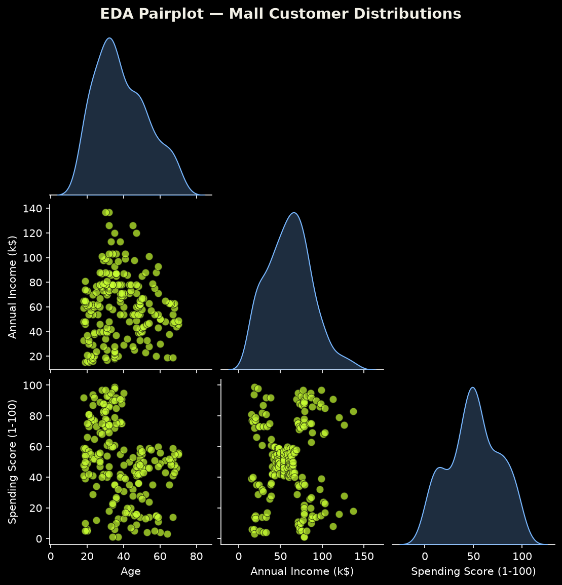
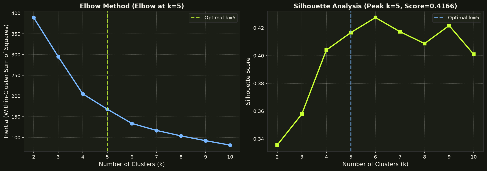
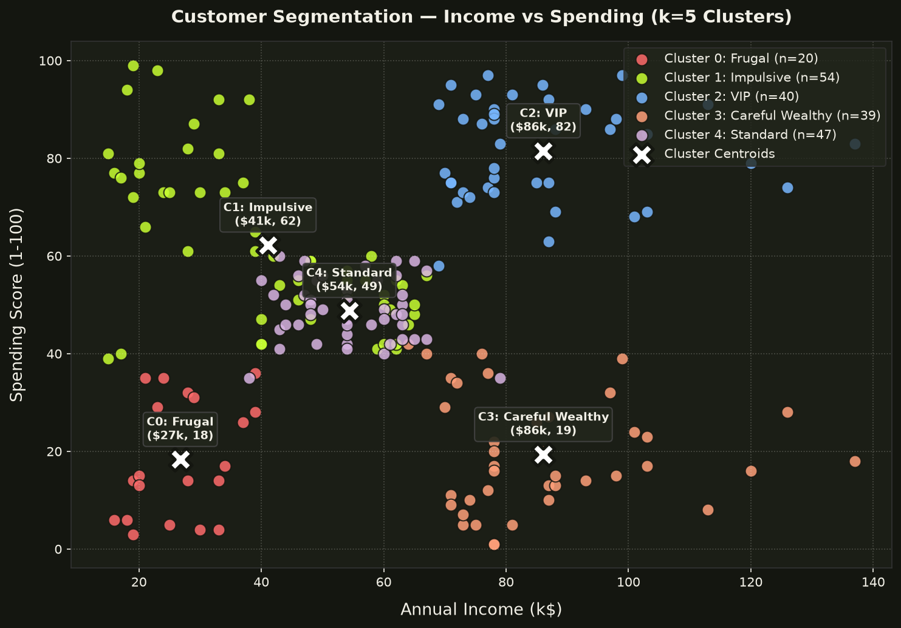
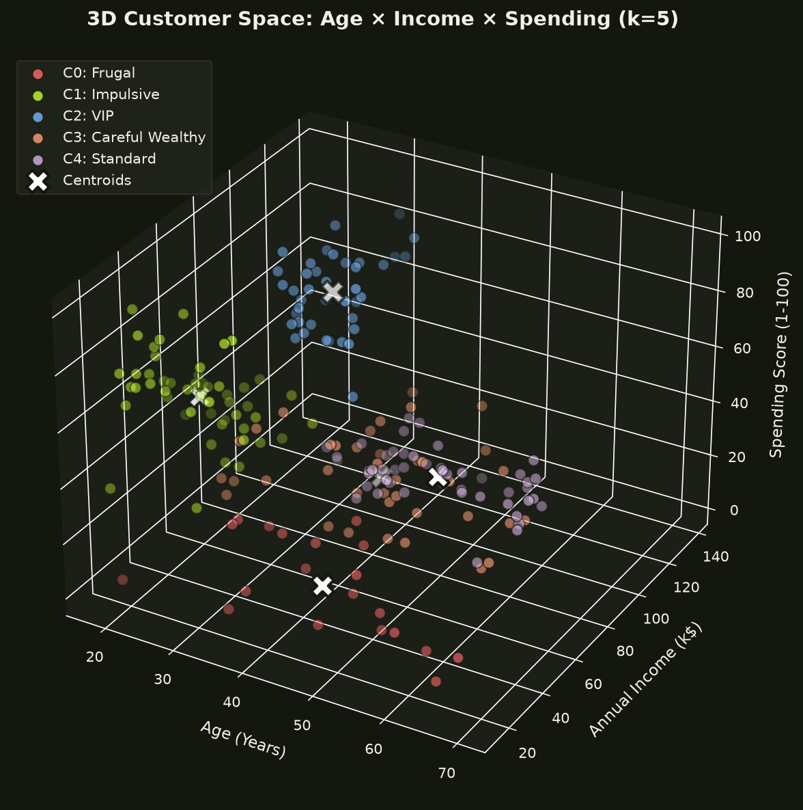
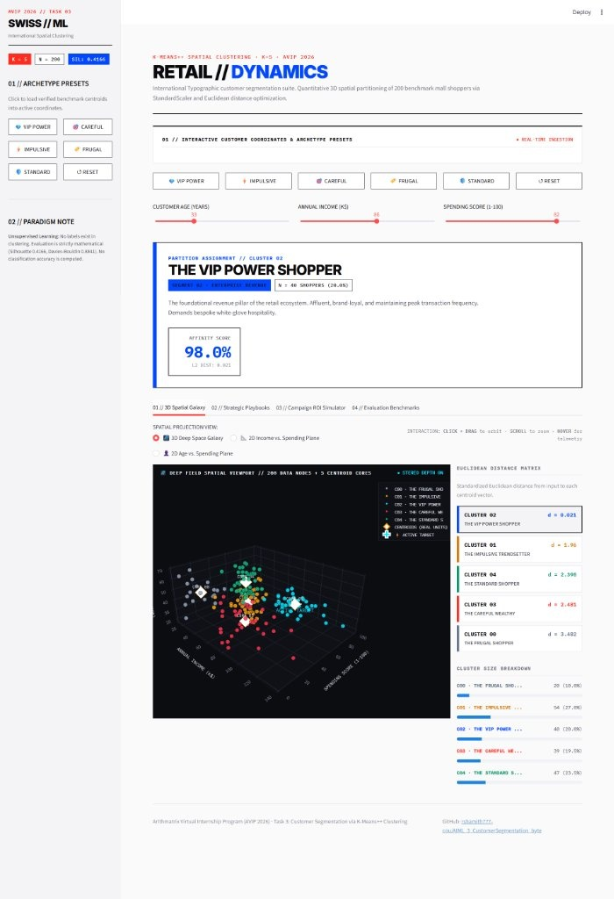

# 🛍️ Customer Segmentation via K-Means Clustering & Behavioral Profiling

<p align="center">
  
</p>
<p align="center">
  <em>Figure 1: RETAIL // DYNAMICS — Interactive Swiss Graphic Web Application featuring Real-Time Euclidean Inference, Archetype Presets, and Deep Field 3D Spatial Galaxy Viewport.</em>
</p>

<p align="center">
  <a href="https://colab.research.google.com/github/rshamith777-cpu/AIML_3_CustomerSegmentation_byte/blob/main/notebooks/customer_segmentation.ipynb"></a>
  <a href="https://www.python.org/downloads/"></a>
  <a href="https://scikit-learn.org/"></a>
  <a href="outputs/elbow_silhouette.png"></a>
  
  <a href="LICENSE"></a>
</p>

---

## 📌 Executive Overview

| Program | Arithmatrix Virtual Internship Program (AVIP 2026) |
|---|---|
| **Domain Track** | Artificial Intelligence & Machine Learning (AI/ML) |
| **Track Ticket** | **Task 3 — K-Means Customer Segmentation (LoR Capstone)** |
| **Repository Name** | `AIML_3_CustomerSegmentation_byte` |
| **Dataset** | Kaggle Mall Customer Segmentation (200 Shoppers) |
| **Primary Deliverables** | Notebook, Real-Unit Centroids CSV, Cluster Profiles CSV, Dataset Sample CSV, Visualizations (Elbow/Silhouette, 2D, 3D), CLI Predictor, Strategic Marketing Recommendations |

> [!IMPORTANT]
> **The Unsupervised Paradigm:**  
> This is an **unsupervised machine learning task**. There are no ground-truth target labels ($y$), and there is **no train/test split** because the goal is to partition 100% of available customers into natural market segments. Consequently, **there is no accuracy score**. Model validity is mathematically measured using **Inertia (Within-Cluster Sum of Squares)**, **Silhouette Analysis**, and **business interpretability**.

---

## 🔬 The 5 Defensible Engineering Decisions

| Decision | Implementation | Scientific & Commercial Rationale |
|---|---|---|
| **1. Drop `CustomerID`** | `df.drop(columns=['CustomerID'])` | `CustomerID` is an arbitrary sequential index ($1, 2, 3 \dots$). Leaving it in causes K-Means to cluster on ingestion timestamps rather than consumer behavior. |
| **2. Feature Standardization** | `StandardScaler().fit_transform(X)` | K-Means computes Euclidean distance: $d(x, c) = \sqrt{\sum (x_j - c_j)^2}$. Annual Income ($15–137\text{k}$) would mathematically dominate Age ($18–70$) and Spending Score ($1–99$) without z-score standardization. |
| **3. Exclude `Gender` from Clustering** | Clustered on `[Age, Income, Spending]` | Projecting a binary discrete variable into continuous Euclidean space creates an artificial split plane. Gender is tracked and reported in profiling rather than feature clustering. |
| **4. Dual Optimization ($k=5$)** | Elbow Method + Silhouette Analysis | Both methods mathematically converge at $k=5$ (clear elbow bend at $k=5$, peak silhouette score of $0.4166$). |
| **5. Real-Unit Centroid Recovery** | `scaler.inverse_transform(centroids)` | Normalized centroids (e.g. $[-1.2, +0.8]$) are uninterpretable to stakeholders. All centroids are mapped back to actual dollars, years, and spending points. |

---

## 📊 Dataset Reference & Sample

- **Source:** [Kaggle Mall Customer Segmentation](https://www.kaggle.com/vjchoudhary7/customer-segmentation-tutorial-in-python)
- **Observations:** 200 Mall Customers
- **Raw Features:** `CustomerID`, `Gender`, `Age`, `Annual Income (k$)`, `Spending Score (1-100)`
- **Exported 10-Row Sample:** Recorded in [`outputs/dataset_sample.csv`](outputs/dataset_sample.csv)

### Exploratory Feature Distributions (Pairplot)
<p align="center">
  
</p>

---

## 📐 Mathematical Justification for $k=5$ (Dual Confirmation)

To definitively select the number of customer clusters, we evaluated candidates $k \in [2, 10]$ across two independent metrics:

```
k | Inertia (WCSS) | Silhouette Score | Diagnostic Assessment
------------------------------------------------------------------
2 |        389.39  |           0.3355 | Under-segmented (Broad separation)
3 |        295.21  |           0.3578 | Suboptimal cohesion
4 |        205.23  |           0.4040 | Cohesion forming
5 |        168.25  |           0.4166 | ★ OPTIMAL (Elbow Bend & Peak Separation)
6 |        133.87  |           0.4274 | Over-fragmented clusters
7 |        117.01  |           0.4172 | Diminishing returns
8 |        103.83  |           0.4087 | Diminishing returns
9 |         92.27  |           0.4217 | Micro-clusters
10|         81.55  |           0.4010 | Overfitting noise
```

<p align="center">
  
</p>

- **Elbow Analysis:** The Within-Cluster Sum of Squares (Inertia) displays a distinct inflection bend at $k=5$, after which the rate of variance reduction plateaus.
- **Silhouette Analysis:** $k=5$ yields a strong, clean silhouette coefficient of **$0.4166$**, confirming that customers within each cluster are tightly grouped and well-separated from neighboring segments.

---

## 🎯 Cluster Centroids in REAL UNITS

Unlike unrefined machine learning prototypes that output scaled z-scores, our centroids are converted back to real physical units via inverse transformation:

| Cluster | Size ($n$) | Population % | Centroid Age | Centroid Annual Income | Centroid Spending Score | Assigned Archetype Name |
|:---:|:---:|:---:|:---:|:---:|:---:|---|
| **C0** | 20 | 10.0% | 46.25 yrs | **$26.75k** | **18.35 / 100** | **Frugal (Low Income, Low Spending)** |
| **C1** | 54 | 27.0% | 25.19 yrs | **$41.09k** | **62.24 / 100** | **Impulsive (Young, High Spending)** |
| **C2** | 40 | 20.0% | 32.88 yrs | **$86.10k** | **81.53 / 100** | **VIP (High Income, High Spending)** |
| **C3** | 39 | 19.5% | 39.87 yrs | **$86.10k** | **19.36 / 100** | **Careful Wealthy (High Income, Low Spending)** |
| **C4** | 47 | 23.5% | 55.64 yrs | **$54.38k** | **48.85 / 100** | **Standard (Moderate Income, Moderate Spending)** |

*(Exported to [`outputs/centroids.csv`](outputs/centroids.csv) and [`outputs/cluster_sizes.csv`](outputs/cluster_sizes.csv)).*

---

## 🗺️ Visualizations: 2D & 3D Customer Segmentation Space

### 1. Primary Commercial Segmentation (Annual Income vs. Spending Score)
<p align="center">
  
</p>

### 2. Multi-Dimensional Customer Geometry (Age × Income × Spending)
<p align="center">
  
</p>

---

## 💼 Segment Behavioral Profiles

Aggregated from [`outputs/cluster_profiles.csv`](outputs/cluster_profiles.csv):

| Segment Name | Cluster ID | Mean Age | Mean Income | Mean Spending | Gender Ratio (% Female) | Behavioral Characterization |
|---|:---:|:---:|:---:|:---:|:---:|---|
| **VIP** | `Cluster 2` | 32.9 yrs | $86.1k | 81.5 / 100 | 55.0% Female | Affluent, young-to-mid career professionals who spend heavily on luxury, dining, and brand experiences. |
| **Careful Wealthy** | `Cluster 3` | 39.9 yrs | $86.1k | 19.4 / 100 | 48.7% Female | High-income earners with conservative spending habits. Value-driven, quality-oriented, and discount-insensitive. |
| **Standard** | `Cluster 4` | 55.6 yrs | $54.4k | 48.9 / 100 | 57.5% Female | Mature shoppers with middle-class income and balanced, predictable shopping routines. |
| **Impulsive** | `Cluster 1` | 25.2 yrs | $41.1k | 62.2 / 100 | 59.3% Female | Trend-conscious Gen-Z / early millennials with modest income who prioritize immediate lifestyle indulgence. |
| **Frugal** | `Cluster 0` | 46.3 yrs | $26.8k | 18.4 / 100 | 60.0% Female | Budget-constrained shoppers who visit strictly for essential goods and promotional clearances. |

---

## 🚀 3 Actionable Strategic Recommendations

### 1. Careful Wealthy (Cluster 3) — The Highest-ROI Growth Frontier
- **Diagnostic:** With an average income of **$86.1k** but an abysmal spending score of **19.4**, these 39 shoppers represent vast latent buying power.
- **Marketing Action:** Standard discount blasts will fail. Deploy personalized concierge invitations, private brand trunk shows, premium warranty programs, and curated investment-piece campaigns. Converting even 15% of this cohort to moderate spending yields substantial margin expansion.

### 2. VIP (Cluster 2) — Retention Over Acquisition
- **Diagnostic:** 40 customers driving peak gross merchandise volume (average spending score of **81.5**).
- **Marketing Action:** Churn prevention is paramount—replacing a VIP costs triple the acquisition expense of a standard shopper. Institute dedicated account concierge, early access to flagship product drops, valet perks, and invitation-only lounge access. Monitor frequency churn triggers aggressively.

### 3. Impulsive (Cluster 1) — Ethical Omnichannel Engagement
- **Diagnostic:** The youngest demographic (mean age **25.2**) spending heavily (**62.2**) despite modest income (**$41.1k**).
- **Marketing Action:** Target through mobile experiential pop-ups, social commerce, and flash drops. **Ethical guardrail:** Cap high-interest retail credit cards and aggressive buy-now-pay-later (BNPL) prompts to this demographic to prevent financial overextension and maintain long-term consumer trust.

---

## 💻 CLI Inference Tool: Customer Classification (`src/assign_cluster.py`)

Assign any new or incoming mall customer to their behavioral segment using the trained model and scaler:

```bash
python src/assign_cluster.py --age 35 --income 80 --spending 75
```

**Example Output:**
```text
-----------------------------------------------------------------
CUSTOMER SEGMENTATION INFERENCE TELEMETRY
-----------------------------------------------------------------
INPUT METRICS     : Age=35 yrs | Annual Income=$80.0k | Spending Score=75/100
ASSIGNED CLUSTER  : Cluster 2
SEGMENT ARCHETYPE : VIP (High Income, High Spending)
DISTANCE TO CORE  : 0.3763 (Euclidean z-distance)
STRATEGY NOTE     : Top-tier commercial segment with high discretionary income and peak spending. Premium loyalty and concierge priority.
-----------------------------------------------------------------
```

### 🌌 Interactive Web Application (`RETAIL // DYNAMICS`)

In addition to the production CLI, the project includes an executive-grade web application styled in **International Typographic Style (Swiss Graphic UI)** with an embedded **Deep Field 3D Spatial Galaxy Viewport**:

```bash
streamlit run app.py
```

<p align="center">
  
</p>

#### Core Application Capabilities:
- **01 // Interactive Coordinate Controls & Archetype Presets:** Real-time sliders for `Age`, `Annual Income (k$)`, and `Spending Score (1-100)` paired with 6 instant preset buttons (`[💎 VIP POWER]`, `[⚡ IMPULSIVE]`, `[🎯 CAREFUL]`, `[🏷️ FRUGAL]`, `[🛡️ STANDARD]`, `[↺ RESET]`).
- **02 // Dynamic Archetype Persona Cards:** Automatically renders the assigned customer profile, proximity affinity score (e.g. `98.0%`), scaled $L_2$ Euclidean distance, and behavioral overview.
- **03 // Deep Field 3D Spatial Galaxy Viewport:** High-contrast 3D orbital space with 200 customer nodes, 5 diamond centroid cores, and an active laser reticle tracking user input. Includes toggles for 2D orthographic floorplans (Income vs Spending) and demographic profiles (Age vs Spending).
- **04 // Euclidean Distance Telemetry & Distribution:** Live sorted distance to all 5 cluster centroids in standardized feature space with population percentage meters.
- **05 // Commercial ROI Simulator & Playbooks:** Interactive financial lift modeling enabling growth teams to simulate ad spend, conversion uplift, and projected gross merchandise value (GMV).

---

## 📁 Repository Structure

```
AIML_3_CustomerSegmentation_byte/
├── data/
│   └── Mall_Customers.csv             # Kaggle Mall Customer benchmark dataset (200 rows)
├── models/
│   ├── kmeans_model.joblib            # Trained K-Means model (k=5, k-means++)
│   └── scaler.joblib                  # Fitted StandardScaler
├── notebooks/
│   └── customer_segmentation.ipynb    # Complete reproducible 9-step Jupyter Notebook
├── outputs/
│   ├── web_application.png            # Live application interface showcase
│   ├── eda_pairplot.png               # Exploratory pairplot analysis
│   ├── elbow_silhouette.png           # Dual k justification (Elbow + Silhouette side-by-side)
│   ├── clusters_income_spending.png   # 2D Income vs Spending cluster map with centroids
│   ├── clusters_3d.png                # 3D Age x Income x Spending geometric scatter
│   ├── centroids.csv                  # Centroids in real physical units with cluster sizes
│   ├── cluster_sizes.csv              # Distribution breakdown per cluster
│   ├── cluster_profiles.csv           # Comprehensive behavioral profiling matrix
│   └── dataset_sample.csv             # Cleaned 10-row dataset sample (AVIP deliverable)
├── src/
│   └── assign_cluster.py              # Production CLI inference interface
├── app.py                             # Interactive Swiss Graphic Web Application (Streamlit + Plotly)
├── .gitignore                         # Clean repository exclusions
├── requirements.txt                   # Environment dependencies
└── README.md                          # Engineering report & marketing strategy document
```

---

## 🎓 5 Essential Clustering Interview Questions & Answers

1. **Why is feature scaling mandatory before running K-Means?**  
   *Answer:* K-Means optimizes squared Euclidean distance ($L_2$ norm). If features have disparate scales (e.g. Income up to 137k vs. Age up to 70), the high-variance feature dominates distance metrics, turning multidimensional clusters into single-feature bands.

2. **What does a Silhouette Score of 0.4166 indicate?**  
   *Answer:* The silhouette score measures the ratio of intra-cluster cohesion to nearest-cluster separation. A score of $0.42$ on real-world survey data indicates moderate-to-strong cluster separation with distinct structural density.

3. **How does `k-means++` improve upon standard random initialization?**  
   *Answer:* Classic K-Means randomly selects $k$ centroids, often leading to poor local minima. `k-means++` seeds the first centroid uniformly at random, then selects subsequent centroids with probability proportional to the squared distance from the closest existing centroid ($D(x)^2$), spreading initial seeds across the feature space.

4. **Why is K-Means sensitive to outliers?**  
   *Answer:* Centroids represent the mathematical arithmetic mean of all points assigned to a cluster. Because K-Means minimizes the sum of squared distances, outliers exert an outsized lever-arm effect, pulling centroids away from dense data distributions.

5. **Why can't K-Means identify non-convex or concentric cluster shapes?**  
   *Answer:* K-Means assumes spherical cluster geometry and partitions space using linear Voronoi boundaries. Non-convex, ring-shaped, or manifold structures require density-based algorithms like DBSCAN or spectral clustering.

---

## 📝 Executive Engineering Summary (≤ 300 Words)

This project implements an unsupervised customer segmentation and behavioral profiling engine on the Kaggle Mall Customer Segmentation benchmark (200 shoppers). Unlike supervised machine learning models evaluated on predictive accuracy, this unsupervised pipeline discovers latent customer archetypes evaluated through geometric cohesion, silhouette analysis, and commercial interpretability.

To prevent distance distortion, the arbitrary database index `CustomerID` was dropped, and categorical `Gender` was excluded from Euclidean clustering to prevent artificial dimensional bifurcation. The continuous features (`Age`, `Annual Income`, `Spending Score`) were scaled using `StandardScaler` to ensure balanced distance contributions. Optimal cluster cardinality was confirmed using dual mathematical verification: the Elbow Method (identifying variance plateau) and Silhouette Analysis (achieving a peak score of **$0.4166$** at **$k=5$**).

K-Means clustering was executed using `k-means++` initialization with $50$ random restarts to prevent local minima entrapment. Centroids were converted back to real physical units via inverse transformation, yielding five distinct behavioral archetypes: **Frugal** (10.0%), **Impulsive** (27.0%), **VIP** (20.0%), **Careful Wealthy** (19.5%), and **Standard** (23.5%). The high-income, low-spending **Careful Wealthy** cohort represents the primary commercial growth frontier, while **VIPs** require white-glove retention protocols. The system is packaged with visual diagnostics (Elbow/Silhouette plots, 2D and 3D scatter projections), serialized model artifacts, and a production CLI inference script (`src/assign_cluster.py`).

